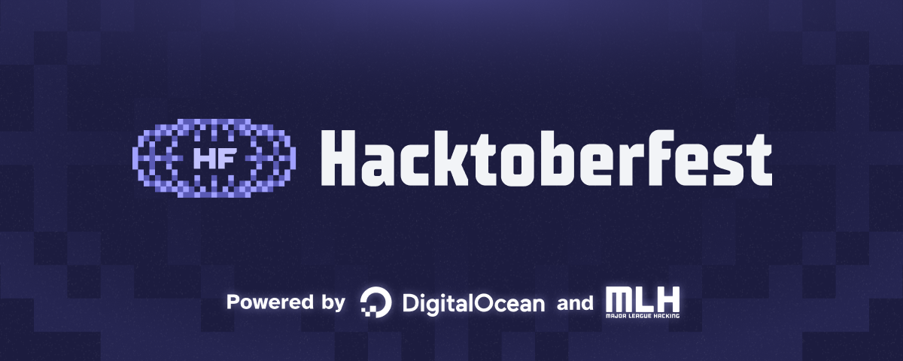

# Hacktoberfest-25-Projects

Looking for Hacktoberfest projects to contribute to?  
This repository curates beginner-friendly, actively maintained open source projects participating in Hacktoberfest 2025. Add your favorite repos or discover new places to make your mark!

  
  

  

## Stay Updated

Please **star this repository** ⭐️  to keep track of all the latest Hacktoberfest projects and updates! Starring will help you quickly find this list and discover new projects throughout the event.

## Projects
| Sr. No | Project                                                                                           | Tech Stack                  | Description                                                                                 |
|--------|---------------------------------------------------------------------------------------------------|-----------------------------|---------------------------------------------------------------------------------------------|
| 0 | [OptiFit](https://github.com/MasterAffan/OptiFit) | Flutter, Python Flask | An AI-powered fitness application that analyzes exercise form via video processing, provides personalized guidance through AI chat, and tracks progress. |
| 1  | [golearn](https://github.com/zhravan/golearn)                                                     | Go                          | Rustlings-style CLI exercises to learn Go by solving and verifying small coding puzzles.     |
| 2  | [terminal-catacomb-crawler](https://github.com/CatacombCrawler/terminal-catacomb-crawler)         | Python                      | Classic ASCII terminal roguelike catacomb/dungeon crawler built with colored retro visuals.  |
| 3  | [rimmel](https://github.com/reactivehtml/rimmel)                                                  | TypeScript, JS, HTML        | UI library for real DOM apps through event streams and functional/reactive paradigms.        |
| 4  | [tix-cli](https://github.com/TheDevOpsBlueprint/tix-cli)                                          | Python                      | Lightning-fast terminal task manager for todos, filtering, and productivity stats.           |
| 5  | [cvimprover-api](https://github.com/CVImprover/cvimprover-api)                                    | Python (Django)             | REST API backend for AI-powered CV/resume generation and optimization.                       |
| 6  | [BOINC](https://github.com/BOINC/boinc)                                                           | Java, Kotlin, PHP           | Platform for volunteer computing providing free computational resources for scientific projects. |
| 7  | [CodeGraphContext](https://github.com/CodeGraphContext/CodeGraphContext)                            | Python, JavaScript          | Helps developers and AI coding tools understand large codebases by building precise code graphs. |
| 8  | [Percupuff](https://github.com/lilyvanoekel/percupuff)                                            | Cmajor, TypeScript, React   | Drum synthesizer generating unique percussion sounds. Runs as plugin, standalone app, or in browser. |
| 9  | [vailabel-studio](https://github.com/vailabel/vailabel-studio)                                    | TypeScript, Python          | Lightweight AI-powered auto labeling tool for fast and intelligent annotation.               |
| 10 | [Daffodil](https://github.com/graycoreio/daffodil)                                                | TypeScript, HTML, CSS       | Ecommerce development framework for building high-quality storefronts with any backend.      |
| 11 | [FEAScript-core](https://github.com/FEAScript/FEAScript-core)                                     | TypeScript, JS, Web         | Run physics and engineering simulations directly in your browser.                            |
| 12 | [weam-ai](https://github.com/weam-ai/weam)                                                        | TypeScript, Python          | AI collaboration hub for connecting LLMs, sharing prompts, and building agents/apps.         |
| 13 | [NodeBox](https://github.com/shreyansh-shankar/NodeBox)                                           | Python                      | Visual automation platform like n8n, but powered by Python nodes.                            |
| 14 | [alix-cli](https://github.com/TheDevOpsBlueprint/alix-cli)                                        | Rust, Shell                 | htop-style terminal UI for managing shell aliases.                                           |
| 15 | [fluss](https://github.com/apache/fluss)                                                          | Java (Python soon)          | Tech modules project: Lakehouses, Vector DBs, Query Engines, Realtime Messaging.             |
| 16 | [hacking-tutorial](https://github.com/amandewatnitrr/hacking-tutorial)                            | Python, Bash                | Cybersecurity foundation repo with hacking scripts and lessons.                              |
| 17 | [topgrade](https://github.com/topgrade-rs/topgrade)                                               | Rust                        | Automates upgrading your system, supports Hacktoberfest with easy "good first issues."       |
| 18 | [github-account-switch-cli](https://github.com/TheDevOpsBlueprint/github-account-switch-cli)      | Go                          | Command-line tool to switch between multiple GitHub accounts seamlessly.                     |
| 19 | [Notakto](https://github.com/rakshitg600/notakto-website)                                        | Next.js, Firebase, WebSocket, Tailwind, React | A unique online board game variant of tic-tac-toe where there’s always a winner. |
| 20 | [The-Dev-Pocket](https://github.com/Darshan3690/The-Dev-Pocket)                                   | Next.js, Supabase, Tailwind | Curated resources, roadmaps, and interactive tools for learners, plus competitive programming platform. |
| 21 | [Awesome SaaS](https://github.com/alchemyst-ai/awesome-saas)                                      | TypeScript, Python          | Collection of templates using the Alchemyst AI Platform for your next big AI app.            |
| 22 | [GraphScript](https://github.com/graphscript-labs/)                                              | Python, JavaScript, Shell   | Visual Scripting Engine (prototype) for building and experimenting with scripting workflows. |
| 23 | [Introduction to Bash Scripting](https://github.com/bobbyiliev/introduction-to-bash-scripting)   | Bash                        | Open-source ebook for learning Bash scripting. Covers basics to help automate SysOps, DevOps, and daily Linux tasks. |
| 24 | [Topic Tracker](https://github.com/kunal534/Topic_Tracker/tree/v1-mvp-working) | Python, APIs | Backend system that tracks, summarizes, and delivers recent updates from YouTube and Reddit for any topic. |
| 25 | [ingest](https://github.com/realChakrawarti/ingest) | React, Node.js, APIs | Build and share public catalogs combining YouTube channels, playlists, and subreddits. Auto-updates every 4 hours with distraction-free feeds. |
| 26 | [Proton](https://github.com/pinely-international/tama) | TypeScript, JavaScript | React-like library that removes root components, supports any state manager, async components, and high customizability. Part of the Denshya frontend ecosystem. |
| 27 | [Super Tiny Icons](https://github.com/edent/supertinyicons/) | SVG | Collection of SVG icons under 1KB each. Creative challenge to fit app and website logos into minimal SVG size. |
| 28 | [Celtrix](https://github.com/celtrix-os/Celtrix) | JavaScript | A web application scaffolder that lets you set up a complete web-project with a single command. |
| 29 | [MailLogSentinel](https://github.com/monozoide/MailLogSentinel) | Python | Lightweight Postfix SASL log watchdog that tracks SASL brute force attempts and exports data to CSV/SQLite for analysis. |
| 30 | [Resonate](https://github.com/resonatehq/resonate/) | Go | Distributed applications programming model. Includes Resonate Server and a custom Deterministic Simulation Test Framework. |
| 31 | [gunicorn-prometheus-exporter](https://github.com/Agent-Hellboy/gunicorn-prometheus-exporter) | Python | Prometheus exporter for Gunicorn metrics such as worker/master performance, request durations, and resource usage. |
| 32 | [Polypm](https://github.com/VesperAkshay/polypm) | Rust, Python, Bash | Unified package manager for managing dependencies in JavaScript and Python projects with a single command. |
| 33 | [MCP Server Fuzzer](https://github.com/tavric-labs/mcp-server-fuzzer) | Python | CLI-based fuzzing tool for testing MCP servers, exposing edge cases, and providing crash reports for debugging. |
| 34 | [Resonate Python SDK](https://github.com/resonatehq/resonate-sdk-py/issues) | Python | SDK for Resonate distributed system programming model, enabling smooth interaction for distributed/agentic systems engineering. |
| 35 | [CodeBoarding](https://github.com/CodeBoarding/CodeBoarding) | Python, LangChain, LSP | Codebase analysis tool that generates interactive diagrams using static analysis and LLM agents to support onboarding and documentation. |
| 36 | [Resonate TypeScript SDK](https://github.com/resonatehq/resonate-sdk-ts/issues) | TypeScript | SDK for Resonate distributed system programming model, enabling developers to build scalable cloud and agentic applications. |
| 37 | [AI Robo Advisor](https://github.com/matvix90/ai-robo-advisor) | Python, LangGraph, Finance APIs | AI-powered robo-advisor that simplifies ETF investing by building and analyzing portfolios with hedge-fund-style strategies. |
| 38 | [Go Interview Practice](https://github.com/RezaSi/go-interview-practice) | Go | Interactive Go interview platform with 30+ coding challenges, tutorials, and package-specific exercises (Gin, Cobra, GORM, Redis, MongoDB). |
| 39 | [OpenRTX](https://github.com/OpenRTX/OpenRTX) | C, C++, CMake | Open-source ham radio and embedded development project, participating in Hacktoberfest with issues for contributors. |
| 40 | [ReqSmith](https://github.com/VesperAkshay/reqsmith) | Python | Command-line API testing tool for REST and GraphQL with AI-powered assistance, caching, and color-coded outputs. |
| 41 | [cutler](https://github.com/hitblast/cutler) | Rust | macOS setup automation tool that configures Macs with a single command and file. |
| 42 | [humdrum](https://github.com/Agent-Hellboy/humdrum) | Python | CLI tool using YouTube Data API v3 to fetch YouTube videos. Can be extended into a TUI with Rich or similar libraries. |
| 43 | [Hacktoberfest2025](https://github.com/yesiamrajeev/Hacktoberfest2025) | C/C++, JavaScript, Python | Beginner-friendly Hacktoberfest project for first pull requests, encouraging participation and contributions. |
| 44 | [Disease Prediction](https://github.com/aliviahossain/Disease-prediction) | Python, JavaScript, HTML, CSS, Flask | Applies Bayes' Theorem for survival prediction based on hospital data with a simple web interface. |
| 45 | [Kestra](https://github.com/kestra-io/kestra) | HTML, CSS, JavaScript | Workflow orchestration platform with 22k+ stars. Offers good first issues, challenges, and giveaways for Hacktoberfest. |
| 46 | [Wooak](https://github.com/aryasoni98/wooak-ssh) | Go | Terminal-based SSH manager with AI-powered recommendations, enterprise-grade security, and intuitive server management. |
| 47 | [spring-blog-backend](https://github.com/HacktoberBlog/SpringBootBackend) | Java, Spring Boot, Firestore, Redis | Backend for a blogging platform with OTP, built for newcomers. Deployed so contributors can see changes live or build their own frontend. |
| 48 | [Spewer](https://github.com/Agent-Hellboy/spewer) | Python | Debugging library for tracing Python execution. Logs variables, function calls, and control flow to explore CPython runtime. Great for learning Python internals. |
| 49 | [Planes](https://github.com/xxxcucus/planes) | C++, Kotlin, Qt, Jetpack Compose | Multiplatform board game app with desktop (Qt), Android (XML), and Jetpack Compose projects. |
| 50 | [Tranzit](https://github.com/kr5hn4/tranzit) | Rust, SCSS, Svelte | Cross-platform local network file-sharing app. Contributions include testing, translations, website updates, and MacOS builds. |
| 51 | [wger](https://github.com/wger-project/wger) | Python, Django, TypeScript, React, Flutter, Dart | Self-hostable fitness app. Multiple repos for backend, frontend, and mobile. Open to code and non-code contributions (UI, translations, docs). |
| 52 | [qryptchat-web](https://github.com/profullstack/qryptchat-web) | JavaScript, Svelte | Quantum-safe end-to-end encrypted chat application. |
| 53 | [Paisable](https://github.com/Code-A2Z/paisable) | JavaScript, HTML, React, Node.js, MongoDB | Full-stack personal finance tracker with OCR using Google Gemini AI. Includes auth, receipts, and live deployment. |
| 54 | [Broken-Link Website](https://github.com/Deadlink-Hunter/Broken-Link-Website) | JavaScript, TypeScript, CSS | Tool for detecting outdated or broken links in GitHub READMEs. Open to devs, designers, and non-code contributors. |
| 55 | [raylib](https://github.com/raysan5/raylib) | C, Lua | Popular graphics library supporting 70+ languages and many platforms. Aimed at making graphics simple to use. |
| 56 | [ZettaNote](https://github.com/braydenidzenga/zettanote) | Node.js, Express, MongoDB, React, Vite | Open-source note-taking app inspired by Notion with Markdown, templates, sharing, and real-time collaboration. |
| 57 | [Guessync](https://github.com/kalviumcommunity/S74_capstone_yogesh_guessync) | JavaScript, React, Node.js, MongoDB, Socket.IO | Real-time multiplayer music guessing game with Spotify/YouTube integration, live chat, AI-powered hints, and typo-tolerant guesses. |
| 58 | [rclip](https://github.com/yurijmikhalevich/rclip) | Python | Command-line photo search tool powered by OpenAI CLIP. Lets you search images by text queries across directories, with terminal image preview support. |
| 59 | [Kubestellar](https://github.com/kubestellar/kubestellar) | Go, Shell, Python | Multi-cluster Kubernetes management with a single control plane. GitOps-native, secure, and edge-friendly with beginner-friendly and advanced contribution opportunities. |
| 60 | [NIfTI-to-DICOM Converter Viewer](https://github.com/AyushMann29/NIfTI-to-DICOM-Converter-Viewer) | TypeScript, JavaScript, Python | Online converter and viewer for 3D medical scans (NIfTI to DICOM) with segmentation masks; needs help with deployment, UI, and docs. |
| 61 | [Standard Agent](https://github.com/jentic/standard-agent) | Python | Small, composable agent runtime with pluggable LLMs, tools, memory, and reasoners; contribute new reasoners, typed tools, and examples. |
| 62 | [Arazzo Engine](https://github.com/jentic/arazzo-engine) | Python | Tools for Arazzo (OpenAPI workflow orchestration). Contribute validations, better errors, and workflow samples. |
| 63 | [Jentic Public APIs](https://github.com/jentic/jentic-public-apis) | API, YAML | Community repo of OpenAPI specs and Arazzo workflows; help with spec repairs, new specs, and quality checks. |
| 64 | [BinEd](https://github.com/exbin/bined) | Java | Modular hex editor with Swing, Android, and IDE plugins; open to feature requests, bug fixes, and new ideas. |
| 65 | [DogLang](https://github.com/pallavrai/doglang) | Python | Dog-themed programming language with its own lexer/parser. Contribute semantic analyzer, REPL, tests, or docs. |
| 66 | [NekoHack](https://github.com/mohitahlawat2001/NekoHack) | JavaScript, HTML | Chrome extension to save/restore tabs in the cloud; help with UI polish, error handling, Firefox support, and encryption. |
| 67 | [tscircuit](https://github.com/tscircuit/tscircuit) | TypeScript | Framework for designing circuit boards with React; fun challenges in code editor, 3D rendering, and viewers. |
| 68 | [Profocto](https://github.com/NiranjanKumar001/Profocto) | JavaScript, TypeScript | Simple resume builder app; contribute UI/UX improvements, features, and bug fixes. |
| 69 | [Minerva](https://github.com/move-fast-and-break-things/minerva) | Python | GPT-powered Telegram bot that aids in learning software dev; contribute features, reminders, and agent improvements. |
| 70 | [CLI for Microsoft 365](https://github.com/pnp/cli-microsoft365) | TypeScript, JavaScript | Command-line tool to manage Microsoft 365, Teams, SharePoint, and more; contribute to option validation and docs. |
| 71 | [101 Linux Commands](https://github.com/bobbyiliev/101-linux-commands) | HTML | Turn Linux commands ebook into a Python CLI tool; beginner-friendly issues for CLI setup, commands, and GitHub Actions. |
| 72 | [TerraQuake API](https://github.com/nagcas/TerraQuakeApi) | JavaScript, HTML | API for real-time and historical earthquake data; contribute endpoints, docs, and usage examples. |
| 73 | [busez](https://github.com/zeforgezenica/busez) | TypeScript, JavaScript | Public transport timetable app for Zenica (Bosnia); looking for contributors of all skill levels for 2025. |
| 74 | [AlumConnect](https://github.com/agastya3636/AlumConnect) | JavaScript | Web platform to connect alumni with their alma mater. Open for contributors to fix bugs, add features, improve docs, and review code. |
| 75 | [Cyclone Node](https://gitlab.com/moe_cyclone/cyclone-node) | Kotlin | Client for qBitTorrent, part of the plexrequests project. Features include category/tag management, file operations, and download control. Future plans: unified backend, auth, and Filebrowser integration. |
| 76 | [smetovi](https://github.com/zeforgezenica/smetovi) | Astro, React (Leaflet), Cloudflare Pages | Tourism promotion platform for the Smetovi mountain (Zenica). Looking for contributors of all levels. |
| 77 | [FletX](https://github.com/AllDotPy/FletX) | Python | Lightweight framework for Flet, inspired by GetX. Includes reactive state management, routing, DI, and modular architecture. |
| 78 | [Uniswap Universal Router Decoder](https://github.com/Elnaril/uniswap-universal-router-decoder) | Python | Decode and encode transactions for Uniswap V2/V3/V4 across Ethereum, BSC, Base, and more. |
| 79 | [Nixopus](https://github.com/nixopus/nixopus) | Go, TypeScript | Open-source alternative to Vercel, Heroku, and Netlify with simplified workflows and a welcoming community. |
| 80 | [Inquizzitive](https://github.com/sb-decoder/inquizzitive) | JavaScript, CSS, HTML | Interactive quiz application built with React. Open for features, bug fixes, and UI/UX improvements. |
| 81 | [NEERF](https://github.com/Itz-Agasta/nerrf) | Shell, Python, Go | Neural Execution Reversal & Recovery Framework — undo computing framework for ransomware/supply chain attack recovery in cloud. |
| 82 | [ClipBin](https://github.com/alight659/ClipBin) | HTML, CSS, Python | Secure and anonymous Pastebin alternative for sharing text and code. Host locally or on web. |
| 83 | [Aibyss](https://github.com/move-fast-and-break-things/aibyss) | TypeScript, Vue, Nuxt, Prisma | Multiplayer coding game where you build AI to compete, with sandboxed code execution. |
| 84 | [AniNotion](https://github.com/mohitahlawat2001/AniNotion) | JavaScript | Journal app to track anime, movies, and books. Beginner-friendly Hacktoberfest project. |
| 85 | [DevUtils](https://github.com/ahammadabdullah/dev-utils) | Electron, React, TypeScript, Vite, Tailwind CSS | Developer utility desktop app with JSON validator, regex tester, UUID generator, converters, and more. |
| 86 | [Openlane](https://github.com/theopenlane) | Go, TypeScript, React, Next.js | Open-source compliance automation platform; contribute to CI, metrics, docs, UI, and tooling improvements. |
| 87 | [Dinka](https://github.com/nios-x/dinka) | MongoDB, Express, React, Next.js (MERN) | Modern social media platform for sharing posts, likes, comments, and real-time interactions. |
| 88 | [Portfolio Website Template](https://github.com/vatsalsinghkv/portfolio-website) | Next.js, TailwindCSS, TypeScript, Framer Motion | Personal portfolio template with animations and modern design; open for UI/UX improvements. |
| 89 | [JobMiner](https://github.com/beingvirus/JobMiner) | Python, Selenium, BeautifulSoup | Web scraping toolkit for extracting job listings and exporting data to CSV/JSON/Excel. |
| 90 | [Quote.Vote](https://github.com/orgs/QuoteVote/projects/1/views/1) | React, Next.js, GraphQL, MongoDB | Nonprofit open-source platform for respectful dialogue and quoting; beginner-friendly issues for frontend, backend, and docs. |
| 91 | [Discord Webhook Library](https://github.com/ctrixcode/discord-webhook-library) | TypeScript | Library for creating richly formatted Discord webhook messages with a builder-style API and modern TypeScript support. |
| 92 | [Pokemon Fetch CLI](https://github.com/ctrixcode/Pokemon-fetch-cli-Go) | Go | Simple CLI tool to fetch Pokémon data from the PokéAPI and store it locally. |
| 93 | [Easy-Fix](https://github.com/vatsalsinghkv/easy-fix) | React, TailwindCSS, TypeScript, Zod | Web app to help contributors find beginner-friendly open-source issues. |
| 94 | [KeyRunes](https://github.com/Keyrunes/keyrunes) | Rust | High-performance authorization engine supporting RBAC, ABAC, and ReBAC; lightweight and secure alternative to Keycloak auth. |
| 95 | [particleFx](https://github.com/Anmol-TheDev/particleFx) | JavaScript, TypeScript, HTML, CSS | Lightweight framework-agnostic library for converting images into interactive particle hover effects. |
| 96 | [Project Nova](https://github.com/AyushMann29/GrabHack-Project-Nova) | Python, HTML | Beginner-friendly project with good-first-issues; open for bug fixes, features, and documentation improvements. |
| 97 | [Factorion Bot](https://github.com/tolik518/factorion-bot) | Rust | Reddit bot that replies with factorial calculations; active on multiple subreddits with 24k+ comments. |
| 98 | [bulletty](https://github.com/CrociDB/bulletty) | Rust | TUI feed reader storing RSS/Atom articles as Markdown for offline sync and Obsidian-style usage. |
| 99  | [package-particleFx](https://github.com/Anmol-TheDev/package-particleFx) | JavaScript, TypeScript, HTML, CSS | Open-source library for particle-based image hover effects with customizable physics and easy React/Vue integration. |
| 100 | [All Leagues Prediction](https://github.com/dagbolade/all_leagues-_prediction) | Python, HTML | AI-powered football prediction platform with match analysis, stats, and model building. |
| 101 | [HelixQue](https://github.com/HXQLabs/Helixque) | JavaScript, TypeScript, HTML, CSS | Real-time networking app using WebRTC and Socket.IO for video calls, chat, and peer-to-peer collaboration. |
| 102 | [rovr](https://github.com/NSPC911/rovr) | Python | Post-modern terminal-based file manager for efficient navigation and file handling. |
| 103 | [DineFit](https://github.com/imkrishnasarathi/DineFit) | JavaScript, TypeScript, HTML, CSS | Smart recipe discovery app tailored to individual dietary preferences. |
| 104 | [AI Tools Hub](https://github.com/ArshdeepGrover/ai-tools-manager) | JavaScript, HTML | Community-driven directory for discovering and categorizing AI tools. |
| 105 | [Component Library](https://github.com/Gyanthakur/component-library) | JavaScript, Next.js, TailwindCSS | Open-source UI component library with reusable elements like buttons and cards. |
| 106 | [Git-Done](https://github.com/ChiragAJain/Git-Done) | Python, JavaScript, HTML, CSS | Productivity tool that tracks deadlines on issues and auto-closes them when PRs are merged; Notion embed support. |
| 107 | [Kodus](https://github.com/kodustech/kodus-ai) | TypeScript | AI-assisted code review platform with AST-level analysis, configurable rules, and PR integration. |
| 108 | [OWASP Nest](https://github.com/owasp/nest) | Python (Django), TypeScript (Next.js), Docker, AWS | Open-source security platform with backend in Django and frontend in Next.js; selected for Google Summer of Code 2025. |
| 109 | [Vector](https://github.com/vectordotdev/vector) | Rust | High-performance observability data pipeline for collecting, transforming, and routing logs, metrics, and traces. |
| 110 | [ChainGate](https://github.com/riz4d/ChainGate) | Python, TypeScript (Next.js), C++ | ChainGate is a modern, blockchain-integrated access control system that combines NFC technology with distributed ledger security and AI-powered analytics. It provides real-time access management, user authentication, immutable audit trails through smart contract integration, and intelligent user behavior analysis through an integrated AI assistant that can answer natural language queries about user access patterns and history.|
| 111 | [Aksharamukha.js](https://github.com/paramsiddharth/aksharamukha.js) | TypeScript, Python | A WASM port of the Python transliteration library Aksharamukha. |
| 112 | [Hacktoberfest 2025 Portfolio](https://github.com/yesiamrajeev/Hacktoberfest2025-Portfolio) | HTML, CSS, JavaScript | Portfolio repo with intentional bugs; contribute by fixing frontend/backend issues like a bug-hunting challenge. |
| 113 | [GFG POTD](https://github.com/Gyanthakur/GFG_POTD) | C++, Python | Daily GeeksforGeeks problem solutions; contribute fixes, enhancements, or new problem submissions. |
| 114 | [DevUI](https://github.com/fahimahammed/DevUI) | TypeScript | Modern shadcn/ui component library with live previews and copyable code snippets; contribute new components and docs. |
| 115 | [EasySwitch](https://github.com/AllDotPy/EasySwitch) | Python | Unified SDK for payment integrations; add new providers, improve docs/tests, and enhance error handling. |
| 116 | [VIVIDUS](https://github.com/vividus-framework/vividus) | Java | Test automation framework; contribute code, docs, bug fixes, or new features to grow the project. |
| 117 | [SinkedIn](https://github.com/Preet-Sojitra/sinkedin) | React, JavaScript | LinkedIn-style platform focused on sharing failures; open for UI/UX and feature contributions. |
| 118 | [Supplements Store Frontend](https://github.com/OpenCodeChicago/hacktoberfest-2025-frontend) | React, Vite, TailwindCSS | E-commerce frontend for supplements; contribute components, responsive layouts, and accessibility fixes. |
| 119 | [OpenUI Library](https://github.com/alirezazim03/OpenUI-Library) | TypeScript, JavaScript | Community-driven component library; add new UI components, improve website, or propose creative designs. |
| 120 | [MFBT Community Website](https://github.com/move-fast-and-break-things/mfbt.community) | HTML, CSS, JavaScript | Community website project; contribute bug fixes, new features, or help migrate to a static-site generator. |
| 121 | [PyDeepFlow](https://github.com/ravin-d-27/PyDeepFlow) | Python | Simplified deep learning library; contribute features, tests, docs, and model enhancements. |
| 122 | [HuloBiral Portfolio](https://github.com/hul0/hulobiral-portfolio-html) | HTML, CSS, JavaScript | Responsive space-themed portfolio with particle effects and custom cursor; contributions for UI/UX welcome. |
| 123 | [GitHub Vulnerability Scanner](https://github.com/ayushmittal62/vulnerability-scanner) | Python, Hugging Face, Gradio, MCP | AI-powered repo vulnerability scanner; add detection features, RAG, RL loop, or improve Gradio UI. |
| 124 | [TouchGrass Chess Engine](https://github.com/datavorous/touchgrass) | Python | Beginner-friendly chess engine; contribute new rules, algorithms, UCI support, or board optimizations. |
| 125 | [GitHub Cards API](https://github.com/akanshSirohi/Github-Cards-API) | JavaScript, HTML, CSS | Generate sleek profile cards via Cloudflare Workers + Satori; contribute new card ideas and themes. |
| 126 | [CocoIndex](https://github.com/cocoindex-io/cocoindex) | Rust, Python | Smart AI data transformation framework for building knowledge graphs and indexes. |
| 127 | [QRSmith](https://github.com/akanshSirohi/QRSmith) | Java | Android QR code library with full customization; contribute new patterns, performance, and sample apps. |
| 128 | [Lisbook](https://github.com/Ctoic/Lisbook) | HTML, CSS, JavaScript | Free audiobook platform with AI-powered summaries and gamified features; open to frontend, backend, and AI/ML contributions. |
| 129 | [d-zone](https://github.com/nntin/d-zone) | TypeScript | Discord-driven ambient life simulator; contribute themes, testing structures, or UI enhancements. |
| 130 | [DeepEval](https://github.com/confident-ai/deepeval) | Python | LLM evaluation framework; contribute to metrics, test cases, docs, and integrations. Beginner-friendly with detailed guidance. |
| 131 | [DeepTeam](https://github.com/confident-ai/deepteam) | Python | Red teaming toolkit for LLMs; improve documentation, add features, write test cases, and help with integrations. |
| 132 | [d-back](https://github.com/nntin/d-back/) | Python | Websocket server and Python package; supports Python 8–13 and WebSockets 10–15. Provides callback-based interfaces and mock data for external projects. |
| 133 | [Moments](https://github.com/ppratik07/moments) | Next.js, TypeScript, TailwindCSS, shadcn/ui, Zustand, Clerk, Node.js, Express.js, Prisma, PostgreSQL | Collaborative photo book app; invite friends to add photos/messages for unique digital gifts. Contribute to features, bug fixes, and backend improvements. |
| 134 | [structured_streamer](https://github.com/PrestonBlackburn/structured_streamer) | Python, HTMX, FastAPI | Stream partial JSON from LLMs into valid JSON with UI examples; contribute features, bug fixes, or docs. Beginner-friendly with `pip install struct-strm`. |
| 135 | [hacktoberfest-2025-backend](https://github.com/OpenCodeChicago/hacktoberfest-2025-backend) | Node.js, Express, MongoDB | Backend for a supplements store; contribute to product APIs, error handling, wishlist endpoints, docs, and testing. |
| 136 | [Responsive Layout Builder](https://github.com/devansharora18/layout) | JSX, TailwindCSS, HTML, CSS | Web tool for creating and testing layouts; split sections, adjust, and export JSX + Tailwind or HTML + CSS. |
| 137 | [ApothecaryShop](https://github.com/mohitahlawat2001/ApothecaryShop) | MERN (MongoDB, Express, React, Node.js), TailwindCSS | Pharmaceutical inventory system; manage stock, procurement, and distribution. Open for full-stack contributions. |
| 138 | [Loco-Musica](https://github.com/mohitahlawat2001/Loco-Musica) | JavaScript, React, Redux Toolkit, TailwindCSS | Fun web app that pairs food vibes with music; contribute to UI/UX, features, or docs. |
| 139 | [Ctrix-Chat-App](https://github.com/ctrixcode/Ctrix-Chat-App) | React, Firebase | Real-time chat app; help with features, UI/UX, and bug fixes. Beginner-friendly issues open. |
| 140 | [Jura](https://github.com/GnautSpace/Jura) | JavaScript | AI-powered legal document assistant that summarizes and reads PDFs; contribute to AI features, bugs, or docs. |
| 141 | [Natrix](https://github.com/serpent-Tools/natrix) | Rust | Ergonomic Rust frontend framework in early development; contribute core features, reactivity runtime, and docs. |
| 142 | [exam-countdown-extension](https://github.com/NovatraX/exam-countdown-extension) | HTML, JavaScript | Browser extension for live exam countdowns, wallpapers, themes, and music; improve popup UI and features. |
| 143 | [HMPL.js](https://github.com/hmpl-language/hmpl) | JavaScript | Server-driven UI templates with minimal JS; contribute to syntax, forms, events, and syncing features. |
| 144 | [Clienvy](https://github.com/Annanyatiwary4/clienvy) | JavaScript | CLI tool that detects secrets, replaces with env vars, and sets up Git pre-commit hooks; contribute features, docs, or bug fixes. |
| 145 | [Obfussor](https://github.com/firuslab/Obfussor) | Rust, Angular (TypeScript) | Cross-platform code editor with live runtime obfuscator for Objective-C & C++; contribute algorithms, plugins, or UI. |
| 146 | [Nackt (Navit GPS)](https://github.com/navit-gps/navit) | C | Free GPS navigation software using OpenStreetMap data; contribute routing, maps, and UI. |
| 147 | [Itinerarly](https://github.com/Heisen47/itinerarly) ([backend](https://github.com/Heisen47/itinerarly-BE)) | TypeScript (frontend), Java (backend) | AI-powered travel itinerary generator across India; contribute to frontend, backend, or deployment. |
| 148 | [Peri](https://github.com/IraSoro/peri) | TypeScript, React | Period tracker app; contribute translations, features, or UI/UX improvements. |
| 149 | [qcx](https://github.com/queuelab/qcx) | TypeScript | AGI interface "planet computer"; open for Hacktoberfest contributions in AI, infra, and tooling. |
| 150 | [Greenstagram](https://github.com/CipherYuvraj/Greenstagram) | React, TypeScript, Node.js, Express, MongoDB | Eco-focused social media platform with gamified green living; contribute to UI/UX, APIs, AI, or PWAs. |
| 151 | [Forklet](https://github.com/AllDotPy/Forklet) | Python | GitHub repo downloader/handler for CI/CD; contribute to CLI, filters, API, and tests. |
| 152 | [CSS Art Museum](https://github.com/pixel-museum/css-art-museum) | CSS | Community gallery of creative CSS art pieces; add art, improve styles, or enhance gallery experience. |
| 153 | [learn-postgresql](https://github.com/fahimahammed/learn-postgresql) | Markdown | Beginner-friendly PostgreSQL guide; improve docs, tutorials, and examples. |
| 154 | [zero-share](https://github.com/ntsd/zero-share) | Astro, Svelte, TypeScript | Secure P2P file sharing with WebRTC and PGP; contribute to UI, encryption, or features. |
| 155 | [Sleipnir](https://github.com/mengdotzip/sleipnir) | Go | Open-source vanity generator for ED25519 public keys; supports CPU & GPU processing. Contributions can include multi-pattern GPU support, documentation, tests, and benchmarks. |
| 156 | [DocsGPT](https://github.com/arc53/DocsGPT) | Python, TypeScript | AI platform for building private agents, assistants, and enterprise search. Supports document analysis (PDFs, Office docs) with privacy control. |
| 157 | [Start Express + React](https://github.com/rocambille/start-express-react) | JavaScript | Educational framework for building web apps with Express + React, including integrated production tools. |
| 158 | [HealthChain](https://github.com/healthchainai/HealthChain) | Python | Open-source Python framework for productionizing AI in healthcare. Handles multiple data systems, FHIR-native NLP pipelines, and FastAPI production APIs. |
| 159 | [YourCSS](https://github.com/Gyanthakur/yourcss_contribution) | CSS | Web app for exploring, interacting with, and copying beautiful CSS designs (buttons, forms, layouts). |
| 160 | [Apollusia](https://github.com/Morphclue/apollusia) | Angular, NestJS, MongoDB | Open-source calendar coordination tool (like Doodle) designed to be free for everyone. Frontend with Angular & Bootstrap, backend with NestJS, MongoDB. |
| 161 | [Sietch](https://github.com/S4tvara/Sietch) | Go | Decentralized, resilient vault system for encrypted files. Peer-to-peer, offline-first, CLI-oriented, lightweight, and privacy-focused. |
| 162 | [SpendWise](https://github.com/Limeload/SpendWise) | Ruby | Beginner-friendly Ruby on Rails project for managing expenses. Good for learning and contributing to collaborative apps. |
| 163 | [tldr-pages](https://github.com/tldr-pages/tldr) | Bash | Community-maintained help pages for command-line tools, simpler alternative to man pages. Contribute by creating or updating pages. |
| 164 | [Affirm](https://github.com/mattlindsey/affirm) | Ruby | Small Ruby on Rails app with a bit of AI; tracks user mood and provides positive reinforcement. |
| 165 | [OpenVScan](https://github.com/Buddhsen-tripathi/openvscan) | TypeScript | Web-based vulnerability scanner integrating open-source tools with AI for smarter pre-production security testing. |
| 166 | [Chat Real](https://github.com/juninhokaponne/chat-real) | React, TypeScript | Real-time P2P video chat platform with WebRTC, camera/mic controls, responsive design, CI/CD ready, and Netlify deployment. |
| 167 | [Love-Calculator](https://github.com/Deepak-Kambala/CupidScore) | HTML, CSS, JS | Beginner-friendly fun web app that calculates a playful “love score” between two names. Contribute by improving UI or animations. |
| 168 | [fheroes2](https://github.com/ihhub/fheroes2) | C++ | Open-source recreation of Heroes of Might and Magic 2 engine. Cross-platform, high-resolution graphics, improved AI, and gameplay. |
| 169 | [Mind_Care](https://github.com/AbhishekChamp879/Mind_Care) | HTML, CSS, JavaScript | Digital mental wellness platform built with React. Open for UI/UX improvements, bug fixes, and new features. |
| 170 | [ChittChat](https://github.com/shambhaveesrivastava12/ChittChat) | JavaScript | Real-time chatting app using MERN stack + Socket.io. Hacktoberfest contributions welcome for UI/UX and feature improvements. |
| 171 | [FinSync360](https://github.com/GreenHacker420/Tally_sync) | JavaScript, TypeScript | Cloud-based ERP integrating Tally ERP, AI analytics, React dashboards, Node.js backend, and FastAPI services. |
| 172 | [HACKTOBERFEST_25_Python](https://github.com/A-K-0/HACKTOBERFEST_25_Python) | Python | Beginner-friendly Python repository for Hacktoberfest contributions. |
| 173 | [Hacktoberfest_2025 Games](https://github.com/ABHIJATSARARI/Hacktoberfest_2025) | HTML, JavaScript | Open-source games for Hacktoberfest 2025. All languages and skill levels welcome. |
| 174 | [unyunddit](https://github.com/profullstack/unyunddit) | JavaScript, PLpgSQL, Svelte | Anonymous Reddit clone for the Tor network with auto-deletion and server-side rendering only. |
| 175 | [PaperScope](https://github.com/Ujjwal-Bajpayee/PaperScope) | Python | Open-source research paper management tool with AI summarization, key insight extraction, and paper organization. |
| 176 | [is-a.software](https://github.com/is-a-software/is-a-software) | JavaScript | Free subdomain service for developers to use in projects. |
| 177 | [pg-wire-mock](https://github.com/The-DevOps-Daily/pg-wire-mock) | JavaScript | Lightweight mock PostgreSQL server to work with psql. Useful for learning, debugging, and testing Postgres protocols. |
| 178 | [zymo.tv](https://github.com/profullstack/zymo-web) | HTML, JavaScript | Self-hosted media server alternative to Emby/Plex. |
| 179 | [T-Race](https://github.com/Ankit-raj-11/T-race) | JavaScript, Next.js | Gamified typing speed platform built with Next.js, beginner-friendly Hacktoberfest issues available. |
| 180 | [SoG Savegame Editor](https://github.com/tolik518/SoG-Savegame-Editor) | C# | Save game editor for Secrets of Grindea; edit player stats, inventory, quests, and export to JSON. |
| 181 | [Trawell](https://github.com/ishpreet36752/Trawell) | JavaScript | MonoRepo full-stack project setup for fast onboarding. Focused on frontend, backend, and database contributions. |
| 182 | [TimeMachine](https://github.com/Harshdev625/TimeMachine) | JavaScript, Node.js | Productivity Chrome extension for tracking website usage, Pomodoro sessions, site blocking, and automated reports. |
| 183 | [Algorithm Visualizer Platform](https://github.com/CipherYuvraj/Algorithm-Visualiser-Platform) | React, Python | Educational tool for interactive algorithm visualization. Frontend with React + TailwindCSS, backend with FastAPI. |
| 184 | [Mini_Python_Projects](https://github.com/RK1905101/Mini_Python_Projects) | Python | Collection of Python mini-projects for Hacktoberfest contributions. Beginners welcome. |
| 185 | [CLI Todo App](https://github.com/flyingSaucer87/cli-todo-app) | Node.js, Python | Interactive command-line task management tool. |
| 186 | [HireTestTakers](https://github.com/profullstack/tutorlinkup-web) | JavaScript, Svelte | Marketplace connecting test-takers with clients; supports cryptocurrency payments. |
| 187 | [OpenGov Africa Hacktoberfest](https://github.com/OpenGovAfrica/hacktoberfest/tree/main) | Markdown | Open-source community for civic tech in Africa; multiple contributor roles (devs, writers, designers, etc.). |
| 188 | [Student Management System](https://github.com/RabindranathChanda/Student_Management_System) | C# | Desktop application for managing student data, beginner-friendly issues labeled for Hacktoberfest. |
| 189 | [HerHaven](https://github.com/nurulain0/HerHaven) | React, Node.js, Express, MongoDB | Women-led open-source platform for creativity and collaboration; frontend, backend, and documentation contributions welcome. |
| 190 | [Pariksha](https://github.com/VishwaKraft/pariksha) | JavaScript | Online quiz portal for MCQ-based exams. |
| 191 | [MERN Expense Tracker](https://github.com/Sathvikaeshkilla/mern-expense-tracker) | JavaScript | Full-stack MERN app with authentication, expense management, chart visualization, and responsive UI. |
| 192 | [Shiksha AI](https://github.com/skully-coder/shiksha-ai) | TypeScript | AI-enabled project for automating lesson plans, worksheets, and educational content in low connectivity areas. |
| 193 | [AsHelp](https://github.com/kris70lesgo/asHelp) | Next.js, TypeScript, Supabase | Platform for assignment management; connects students to top-performing peers, handles secure transactions, modern responsive web app. |
| 194 | [Podcast Hub](https://github.com/cryptohub53/podcast-hub) | Next.js, TailwindCSS | Discover podcasts using a simple and interactive web interface. |
| 195 | [Valkyrie](https://github.com/AllDotPy/Valkyrie) | Python | Open-source security scanner for CI/CD pipelines; detects secrets leakage, vulnerable dependencies, and risky IAM configs. Contributors can add scanning rules, plugins, CI/CD integrations, and docs. |
| 196 | [GoPredict](https://github.com/harshitaphadtare/GoPredict) | Python | Machine learning project for predicting trip durations using regression models and advanced feature engineering. Contributions welcome for model optimization and frontend improvements. |
| 197 | [fastkml](https://github.com/cleder/fastkml) | Python | Library to read, write, and manipulate KML files efficiently. Handles geometries via pygeoif, supports KML clients like Google Earth and OpenLayers. Beginner-friendly issues available. |
| 198 | [QAManagementSystem](https://github.com/Pythagora-io/QAMangementSystem) | TypeScript | QA management platform integrating Linear, MongoDB, charts, and email automation. Contributions open for backend, dashboard improvements, and testing. |
| 199 | [ngx-stories](https://github.com/Gauravdarkslayer/ngx-stories) | TypeScript, SCSS | Angular component for rendering Instagram/WhatsApp-style stories. Contributors can add new features, fix issues, or improve UI animations. |
| 200 | [MERN Project CLI](https://github.com/manishraj27/mern-project-cli) | JavaScript | Command-line tool for scaffolding and managing MERN stack projects. Help by fixing bugs, improving docs, and adding new templates or features. |
| 201 | [NetworkTopologyAnalyser](https://github.com/Gouging-Infernos/NetworkTopologyAnalyser) | Python | Network scanner that detects devices, subnets, and visualizes topology. Perfect for networking and cybersecurity contributors. |
| 202 | [PtitPrince](https://github.com/pog87/PtitPrince) | Python | Python implementation of the Raincloud plot for elegant data visualization. Contributions open for code improvements and docs. |
| 203 | [diffgraph-cli](https://github.com/WildestAI/wild) | Python | AI-powered CLI tool that visualizes git code changes and generates dependency graphs. Help improve AI understanding, HTML reports, or CLI UX. |
| 204 | [Hopp](https://github.com/gethopp/hopp) | TypeScript, React, TailwindCSS, Go, Rust | Open-source pair programming and API testing app. Contributors welcome for frontend, backend, and Rust core improvements. |
| 205 | [OpenSauce](https://github.com/xthxr/OpenSauce) | Python, Java | Beginner-friendly repository for Data Structures and Algorithms in multiple languages. Open for new implementations and optimizations. |
| 206 | [SafePathAI](https://github.com/SrinjoyeeDey/SafePathAI-AI-Powered-Safety-Assistance) | TypeScript, React, Node.js, MongoDB, TailwindCSS | AI-powered personal safety and assistance app. Frontend and backend contributions welcome for UI, map integrations, and AI features. |
| 207 | [Real-Time Code Editor](https://github.com/siddxharth1/real-time-code-editor) | React, Node.js, Socket.IO, Redis, Monaco Editor, TailwindCSS, NextUI (HeroUI currently) | Collaborative coding platform where multiple users can code, chat, and brainstorm together in real time. Includes multi-language syntax highlighting, live code execution, and room-based sessions with user presence. [Live Demo](https://code-buddies-mern.vercel.app/) |
| 208 | [CuraVibe](https://github.com/ayyush08/CuraVibe) | Next.js, Monaco Editor, WebContainers, Xterm.js, MonacoPilot | Browser-based IDE supporting React, Next.js, Express, Hono, Vue, and Angular templates. Features include in-browser coding, integrated terminal, persistent file storage, and AI-assisted code suggestions. Open to contributions for new templates, features, and production improvements. |
| 209 | [TravelBook](https://github.com/Sahilll94/Travel-Book) | MERN Stack (MongoDB, Express, React, Node.js) | A web app where users can store and revisit travel memories with titles, images, and descriptions. Open for Hacktoberfest 2025 contributions in UI improvements, new features, bug fixes, and performance optimization. |
| 210 | [ShareBite](https://github.com/angelabera/ShareBite) | HTML, CSS, JavaScript | A responsive web platform connecting restaurants and households with NGOs and volunteers to reduce food waste and fight hunger in communities. Beginner-friendly project ideal for Hacktoberfest contributors. |
| 211 | [Collaborative Notepad](https://github.com/sh13y/Collaborative-Notepad) | JavaScript, Node.js, WebSockets | A real-time collaborative notepad where multiple users can type simultaneously and see live cursors. Think Google Docs, but open source and community-built for Hacktoberfest. |
| 212 | [Universal-Box](https://github.com/Abhishek-Mallick/universal-box) | Node.js, CLI, Template Engine | A powerful open-source CLI tool for instantly scaffolding full-stack, AI, and mobile app templates. Contribute new templates, improve CLI commands, or enhance developer experience this Hacktoberfest. |
| 213 | [Browse Movies](https://github.com/champst2004/browse-movies) | React, Vite, JavaScript | A modern movie browsing app with responsive UI, API integration, dark mode, and interactive features. Ideal for React learners to contribute during Hacktoberfest 2025. |
| 214 | [SuperDribble](https://github.com/SuperPlugs/SuperDribble) | Web Audio API, WebAssembly (C++), Lua, JavaScript | A web extension for real-time audio amplification and equalization. Features a 10-band EQ, WASM DSP engine, and modern UI. Contribute to performance, effects, or UI improvements. |
| 215 | [NexusTimer](https://github.com/bryanlundberg/NexusTimer) | TypeScript, Next.js, React, shadcn/ui | A speedcubing web app with local IndexedDB storage. Contributors can enhance security, UI responsiveness, testing, and add new ideas. Easy local setup and beginner-friendly. |
| 216 | [AI Recruiter](https://github.com/Zaki-Mohd/ai-recruiter) | Next.js, JavaScript | An AI-powered interview practice app with real-time voice-to-text, AI-generated technical questions, and feedback. Open issues for UI redesign, authentication flow, and bug fixes—perfect for Hacktoberfest 2025. |
| 217 | [SuperBook](https://github.com/SuperPlugs/SuperBook) | React, Tailwind CSS | A Chrome extension that enhances your reading experience by providing instant word definitions and text interaction on any webpage. Lightweight, privacy-focused, and beautifully designed. |
| 218 | [HackWithZairza](https://github.com/zairza-cetb/HackWithZairza) | Multiple Domains (Web Dev, DSA, AI, Cybersecurity, Automation) | A community-driven open-source initiative for first-timers to contribute across diverse domains during Hacktoberfest 2025. |
| 219 | [Readme_Hactoberfest25](https://github.com/A-K-0/Readme_Hactoberfest25) | Markdown | A collection of the best GitHub profile README files. Contribute your own personal README and get featured. |
| 220 | [Hackathon Starter](https://github.com/sahat/hackathon-starter) | JavaScript, Node.js, Pug | A boilerplate for Node.js web applications. Includes authentication, API integrations, and essential project setup. Great for building new web apps fast. |
| 221 | [Lichess4Chess](https://github.com/Ryrden/lichess4chess) | TypeScript, Chrome Extension | A Chrome extension that lets you analyze your finished Chess.com games on Lichess using free AI tools. Includes multi-language support, update pages, and customization features. |
| 222 | [I Love You Website](https://github.com/Deepak-Kambala/Romelette) | HTML, CSS, JavaScript | A simple and romantic web app that greets users with a personalized “I love you” message, animated hearts, and sparkly effects. Perfect beginner-friendly mini project. |
| 223 | [Web Scrapping Examples](https://github.com/amolsr/web-scrapping) | Python, Beautiful Soup | A beginner-friendly collection of web scraping examples using BeautifulSoup in Python. Learn and contribute more scrapers and tutorials. |
| 224 | [Text-Type Detection](https://github.com/profullstack/text-type-detection) | Node.js | A lightweight Node.js module for detecting text types such as plain text, markdown, HTML, JSON, or code blocks. Zero dependencies and ideal for text-processing projects. |
| 225 | [Initly](https://github.com/anup2702/initly) | JavaScript, Node.js, CLI | A simple CLI tool to scaffold project templates, currently supporting MERN stack with Docker. Perfect for adding new stacks, improving templates, or enhancing the CLI. |
| 226 | [ByteChef](https://github.com/bytechefhq/bytechef) | JavaScript, JSON, Workflow Automation | A low-code/no-code automation and API integration platform. Features UI workflow editor, built-in code editor, AI-ready components, and self-hosting capabilities. Scalable and developer-friendly. |
| 227 | [AiVoiceClonerPRO](https://github.com/AryanVBW/AiVoiceClonerPRO) | Python | An easy-to-use Voice Conversion framework based on VITS, powered by python. |
| 228 | [VPrep_Interview_Bot](https://github.com/mainak0907/VPrep_Interview_Bot) | TypeScript, JavaScript, CSS | Interview Agent powered by Assembly AI and Gemini to help you improve Speaking skills in an interview. |
| 229 | [HealthAI Assistant](https://github.com/NikhilRaikwar/HealthAI-Assistant) | TypeScript | An AI-powered healthcare assistant that provides medical information, symptom analysis, and health recommendations using Google's Gemini AI. |
| 230 | [whisper.net](https://github.com/sandrohanea/whisper.net/) | C# | Speech-to-text made simple using Whisper Models. |
| 231 | [post-quantum-helper](https://github.com/profullstack/post-quantum-helper) | JavaScript | A tool that automates file uploading, originally for UploadThing, and features Post-Quantum Secure key encapsulation (ML-KEM). |
| 232 | [ut](https://github.com/afterfiveguy/ut) | Go | A tool primarily made to automate file uploading to UploadThing. Contributions are welcome. |
| 233 | [yappin](https://github.com/Polqt/yappin) | SvelteKit, TypeScript, TailwindCSS, Go, PostgreSQL | A real-time chat application with modern features built with SvelteKit/Go; looking primarily for frontend contributors. |
| 234 | [quantum-database-backups](https://github.com/profullstack/quantum-database-backups) | JavaScript | Automates secure database backups using Supabase CLI, encrypts them with Post-Quantum Encryption, and sends them via email. |
| 235 | [Docspect](https://github.com/Sreyasiv/Docspect) | JavaScript | An AI-powered tool to detect risky clauses, summarize legal documents, and explore relevant case studies. |
| 236 | [ab-img-gen](https://github.com/hanzalahwaheed/ab-img-gen) | TypeScript | A simple, fast tool to create side-by-side comparison images (Version A vs. Version B) for social media polls and design feedback. |
| 237 | [make-it-oss](https://github.com/architech-devs/make-it-oss) | React, Express, Mongo (Full Stack) | Automates open-source readiness for any GitHub project by generating and validating community guideline files (LICENSE, README, etc.). |
| 238 | [activelrs](https://github.com/RaceRocks/activelrs) | Ruby | A lightweight Rails gem (API wrapper) for working with xAPI data, enabling ORM-like filtering and ordering on fetched data. |
| 239 | [access-anywhere](https://github.com/rahulparihar-30/access-anywhere) | React Native (Frontend) | The frontend for a project that aims to turn a phone into a secure remote for a computer's file system, focusing on true remote access and E2E encryption. |
| 240 | [access-anywhere-server](https://github.com/rahulparihar-30/access-anywhere-server) | Python/Flask API (Backend) | The backend for a project aiming to provide secure, remote access to a computer's file system via a phone. |
| 241 | [devmd](https://github.com/suryanshsingh2001/devmd) | TypeScript (Next.js) | A free tool that uses Gemini AI to convert Medium articles to clean dev.to Markdown in seconds, preserving formatting. |
| 242 | [FolderFlow](https://github.com/VarunBhattacharya/FolderFlow) | Python | A simple Python script (Digital Butler) to automatically organize files in a directory by sorting them into dedicated subfolders based on file type. |
| 243 | [wandern](https://github.com/s-bose/wandern) | Python | A minimal CLI tool for managing database migrations, currently supporting SQLite and PostgreSQL, with optional LLM integration for generation. |
| 244 | [portfolio](https://github.com/kingsmen732/Zapfolio) | React | An open-source, minimal, and fast Bento-style personal website built with React, easily customizable via a config file. |
| 245 | [cua](https://github.com/trycua/cua) | Python, Swift | Open-source infrastructure (Sandboxes, SDKs, benchmarks) for Computer-Use Agents (AI agents that can control full desktops). |
| 246 | [aethel](https://github.com/Homies-Tech-Innovation/aethel) | React, Node.js | A markdown editor with a planned AI agent that can take actions on documents; currently in the documentation/brainstorming phase. |
| 247 | [StallOs](https://github.com/Zaki-Mohd/StallOs) | TypeScript, React, GSAP, Gemini, Supabase | An app featuring an AI Sous-Chef (Chaat-GPT) that provides live recipe advice. |
| 248 | [Idea-Vault](https://github.com/Stavin13/Idea-Vault) | TypeScript (Full Stack) | A full-stack open-source platform for sharing ideas. |
| 249 | [venuedating-web](https://github.com/profullstack/venuedating-web) | JavaScript (PWA) | A modern Progressive Web App (PWA) that connects people at their favorite venues, powered by Supabase. |
| 250 | [floss-toolbox](https://github.com/Orange-OpenSource/floss-toolbox) | Python, Shell, Ruby | A repository gathering tools and scripts to help people manage GitHub and GitLab organizations or repositories using their APIs. |
| 251 | [ai-content-catalyst](https://github.com/akashcorex/ai-content-catalyst) | TypeScript | An AI-powered platform generating blog titles, social captions, and YouTube descriptions using Gemini AI with 30+ templates. |
| 252 | [turron](https://github.com/Fl1s/turron) | Java | A video search system (Video Shazam) that analyzes short clips to find their original source using perceptual hashing; needs frontend UI help. |
| 253 | [gssocFAQ-Bot](https://github.com/piyushpatelcodes/gssocFAQ-Bot) | HTML, JavaScript | A popular 24/7 Discord bot designed to answer repetitive questions and provide project details for the GSSOC 2025 event. |
| 254 | [openplace](https://github.com/openplaceteam/openplace) | TypeScript | A free and open-source backend implementation of wplace, allowing users to run their own private server. |
| 255 | [sedona-db](https://github.com/apache/sedona-db) | Rust | An open-source, single-node analytical database engine built in Rust that treats geospatial data as a first-class citizen for blazing-fast spatial analytics. |
| 256 | [IDE21](https://github.com/nebojsatomic/IDE21) | PHP | A CMS that allows users to design and develop templates within the administration area, even using a mobile phone. |
| 257 | [The-Nexus](https://github.com/whatsupsumit/The-Nexus) | JavaScript, CSS | A cutting-edge streaming entertainment platform built with React, featuring movies, TV series, and advanced user management. |
| 258 | [FreifunkCompanion](https://gitlab.com/derTizen/FreifunkCompanion) | Kotlin | An Android application project for 'Freifunk' (free open wireless network), aiming to implement the news hub and map features, for F-Droid readiness. |
| 259 | [AlgoVisualizer](https://github.com/mahaveergurjar/AlgoVisualizer) | React.js, Vite, CSS Modules | An interactive web app to visualize sorting, pathfinding, and graph algorithms in real-time, perfect for beginners. |
| 260 | [MyCSES](https://github.com/ks-iitjmu/MyCSES) | C++, Python, Java | A curated collection of CSES Problem Set solutions and explanations, organized by topic for mastering algorithms. |
| 261 | [DEV_ELEVATE-main-](https://github.com/Satya900/DEV_ELEVATE-main-) | React, TypeScript, Tailwind CSS, Firebase | A modern learning platform (Develevate) for developers with interactive tutorials, a built-in code compiler, and structured learning paths. |
| 262 | [Dev_Profiles](https://github.com/Gyanthakur/Dev_Profiles) | HTML, CSS | A place to list and showcase developer skills and profiles. |
| 263 | [sedona](https://github.com/apache/sedona) | Java, Scala, Python | Apache Sedona, the most popular open-source cluster computing engine for processing large-scale geospatial data; looking for GeoPandas API contributions. |
| 264 | [echomail](https://github.com/Agent-Hellboy/echomail) | Go | An email reader for Mac that converts technical blogs and emails into audio for hands-free listening. |
| 265 | [Poseidon-s-Trident](https://github.com/Cyber-Samurai-Group/Poseidon-s-Trident) | Python, TypeScript | A cybersecurity project focused on Threat Detection, Protection, and Response. |
| 266 | [ouds-ios](https://github.com/Orange-OpenSource/ouds-ios/) | Swift | An open-source brand new design system for iOS, with small issues perfect for newcomers. |
| 267 | [meshhook](https://github.com/profullstack/meshhook) | SvelteKit, Svelte 5, Supabase (Postgres) | An MIT-licensed, webhook-first workflow engine featuring a visual builder and Temporal-like durability via event sourcing. |
| 268 | [diy-analytics](https://github.com/heysagnik/diy-analytics) | Next JS, MongoDB | A self-hostable analytics platform built with simplicity in mind, seeking contributions to take it to the next level. |
| 269 | [SkyBuddy](https://github.com/SrinjoyeeDey/SkyBuddy) | React, TypeScript, Tailwind CSS | A beautiful, lightning-fast, and interactive weather dashboard with features like city search, favorites, and planned AI enhancements. |
| 270 | [dodo-bot](https://github.com/mohitjoer/dodo-bot) | Python | A Discord bot that helps users fetch GitHub profiles and repository details directly from Discord. |
| 271 | [Hacktoberfest2025-Pixelated-Draw](https://github.com/yesiamrajeev/Hacktoberfest2025-Pixelated-Draw) | JavaScript, CSS, HTML | A pixelated drawing project welcoming contributions to improve the design. |
| 272 | [loadbalancer](https://github.com/ardatosun/loadbalancer) | Go | A load balancer implementation built for fun, looking for contributors to help continue its development. |
| 273 | [SauLM](https://github.com/Athaxv/SauLM) | TypeScript, JavaScript | A persona-based AI legal assistant that provides concise, law-focused guidance tailored to different personalities (e.g., Harvey Specter). |
| 274 | [kanadojo](https://github.com/lingdojo/kana-dojo) | TypeScript | A fun, minimalist, and aesthetic platform for learning kanji and Japanese, inspired by Monkeytype, with over 5,000 monthly active users. |
| 275 | [DecodeDsa](https://github.com/V-Sharanya/DecodeDsa) | TypeScript, React.js, Tailwind CSS | An interactive and responsive web app designed to visualize core Data Structures and Algorithms (DSA) concepts in a fun, easy-to-understand way. |
| 276 | [election-bot](https://github.com/theSoberSobber/election-bot) | TypeScript | A Discord bot that allows you to conduct cryptographically secure elections and sell electoral bonds with automated price discovery. |
| 277 | [custom-wordle](https://github.com/Glowstick0017/custom-wordle) | Next.js, TypeScript, Tailwind CSS | A Next.js app that lets users create and share custom Wordle games with ANY word length and customizable guess limits. |
| 278 | [vyoma-ui](https://github.com/Srijan-Baniyal/vyoma-ui) | TypeScript | A beautiful component library built on top of Shadcn/ui, featuring "Spatial Wisdom Inside." |
| 279 | [irx](https://github.com/arxlang/irx) | Python | A BSD-licensed, llvmlite-based toolchain that converts language-agnostic ASTx into LLVM IR and native binaries; focused on type support and codegen. |
| 280 | [SysMood](https://github.com/RayBreeze/SysMood) | C++ | A simple Beginner Friendly C++ Based CLI Tool for Windows (Linux coming) that fetches system stats and interprets them into fun "moods." |
| 281 | [discord-webhook-manager](https://github.com/ctrixcode/discord-webhook-manager) | TypeScript | A tool designed to make managing Discord webhooks effortless, allowing users to create, update, delete, and view them in one place. |
| 282 | [Diffium](https://github.com/kubeden/diffium) | Go | A CLI tool that visualizes git diffs with AI-powered insights to help developers understand code changes. |
| 283 | [StratOS-maneki-neko](https://github.com/StratOS-Linux/stratos-maneki-neko-qt6) | Python | The custom welcome application for the StratOS Linux distribution. (Part of the StratOS-Linux organization.) |
| 284 | [StratOS Website](https://github.com/StratOS-Linux/stratos-linux.github.io) | Astro, Starlight | The website for the StratOS Linux distribution, built with Astro and Starlight. (Part of the StratOS-Linux organization.) |
| 285 | [Rockers](https://github.com/StratOS-Linux/rockers) | Rust | The custom package manager script for the StratOS Linux distribution. (Part of the StratOS-Linux organization.) |
| 286 | [Grab](https://github.com/StratOS-Linux/grab) | C++ | The custom fetch tool for the StratOS Linux distribution. (Part of the StratOS-Linux organization.) |
| 287 | [mcp-containers](https://github.com/metorial/metorial) | TypeScript, Docker | Containerized versions of hundreds of MCP (Model Context Protocol) servers. |
| 288 | [FaceDetection\_Prototype3](https://github.com/yesiamrajeev/FaceDetection_Prototype3) | Python, OpenCV, Flask | A Face Detection Attendance System integrating machine learning with real-time web functionality, aimed at helping beginners. |
| 289 | [chip8-emulator](https://github.com/python-fuse/chip8-emulator) | C++, SFML, Dear ImGui | A CHIP-8 Emulator open to contributions for new OPCODES and UI improvements. |
| 290 | [HordVoice](https://github.com/HordRicJr/HordVoice) | Flutter | An AI-powered voice assistant built with Flutter and Azure AI Services. |
| 291 | [TAIL.ai](https://github.com/TejasS1233/TAIL.ai/issues) | MERN Stack (MongoDB, Express, React, Node.js) | A visual AI agent builder platform utilizing the MERN stack, accepting contributions for Hacktoberfest. |
| 292 | [StackMate](https://github.com/nst-sdc/StackMate) | TypeScript, JavaScript | A multi-purpose VS Code extension that includes notes, JSON tools, color picker, and AI features to make coding easier. |
| 293 | [MazeBuilder](https://github.com/zmertens/MazeBuilder) | C++ | An open-source learning project that converts simple commands into complex maze strings, usable for game level generation, datasets, and artwork. |
| 294 | [jarvis](https://github.com/vannu07/jarvis) | Python, OpenCV | A voice-controlled AI assistant with face recognition, offering features like voice commands for PC control and WhatsApp/YouTube automation. |
| 295 | [Client-Interface](https://github.com/BharatSeva/Client-Interface) | ReactJS, JavaScript | The Frontend (ReactJS) repository for BharatSeva, a real-world project empowering healthcare through tech. |
| 296 | [HealthCare-Interface](https://github.com/BharatSeva/HealthCare-Interface) | ReactJS, JavaScript | The Frontend (ReactJS) repository for BharatSeva, a real-world project empowering healthcare through tech. |
| 297 | [Client and Healthcare server (BharatSeva)](https://github.com/BharatSeva) | Golang | The server-side component (Golang) for the Client and Healthcare interfaces of the BharatSeva project. |
| 298 | [logixia](https://github.com/Logixia/logixia) | TypeScript | An enterprise-grade TypeScript logging library for modern Node.js apps with custom log levels, multiple transports, and analytics support. |
| 299 | [TripTreat](https://github.com/Lanthoiba2022/TripTreat) | React, TypeScript, Supabase, Tailwind | A booking platform for Northeast India's homestays, eateries, and experiences, seeking help with bug fixes and feature additions. |
| 300 | [smart-stocks](https://github.com/VishwaKraft/smart-stocks) | Python | A project using Machine Learning models to predict the price of stocks, aimed at building understanding of trading platforms. |
| 301 | [terraform-provider-validatefx](https://github.com/The-DevOps-Daily/terraform-provider-validatefx) | Go | An open-source Terraform provider that adds handy validation functions like `is_email`, `is_uuid`, and more. |
| 302 | [snippetstudio](https://github.com/alexanderdombroski/snippetstudio) | TypeScript | A VS Code extension for managing snippets, currently focusing on feature research and documentation for big ideas. |
| 303 | [open-project-lab](https://github.com/spyder01/open-project-lab) | Markdown | An open-source hub of curated project ideas and submissions across various development categories (Web, AI/ML, Game Dev, etc.). |
| 304 | [ClassFetch](https://github.com/DeeptejD/ClassFetch) | JavaScript | A project welcoming Hacktoberfest contributions for new features and issues. |
| 305 | [HordricWeather](https://github.com/HordRicJr/HordricWeather) | Flutter | A modern and free Flutter weather app with accurate forecasts, smart alerts, air quality, Android widget, and privacy-respecting features. |
| 306 | [Superheroes-API](https://github.com/CyrilBaah/Superheroes-API) | Python | A Superheroes API welcoming contributions to fix bugs, add new heroes, or improve features. |
| 307 | [debezium (AndrGab)](https://github.com/AndrGab/debezium) | FastAPI, WebSocket | A WebSocket-based FastAPI project demonstrating real-time Change Data Capture (CDC) using Debezium and Kafka for educational purposes. |
| 308 | [groupvoyage](https://github.com/harshmangalam/groupvoyage-web) | TypeScript, JavaScript | A platform to find local groups, compare prices, and join budget-friendly weekend trips. |
| 309 | [the-button-that-does-nothing](https://github.com/thecodersroom/the-button-that-does-nothing) | JavaScript | A project focused on "making something useful with something useless" by building a button that does nothing. |
| 310 | [hermyx](https://github.com/spyder01/hermyx) | Go | A blazing-fast reverse proxy written in Go, built on top of `fasthttp`, designed for speed, caching, and simplicity. |
| 311 | [activity-log](https://github.com/TheDanniCraft/activity-log) | JavaScript | A GitHub Action that automatically updates a user's README.md with their latest GitHub activity (commits, PRs, issues). |
| 312 | [tsbin](https://github.com/P8labs/tsbin) | TypeScript | A lightweight, open-source snippet/paste-sharing tool. |
| 313 | [Zenly](https://github.com/Rushorgir/Zenly) | TypeScript, JavaScript | An open-source mental wellness platform designed to help people find calm, clarity, and support through curated resources and an elegant UI/UX. |
| 314 | [EasyWiFi](https://github.com/localrice/EasyWiFi) | C++ | An alternative, lightweight WiFi manager for ESP32 devices, focusing on essential WiFi functionality. |
| 315 | [Lets-Talk-CDC-Change-Feed-Playground](https://github.com/sandgraal/Lets-Talk-CDC-Change-Feed-Playground) | TypeScript, JavaScript, CSS | A free playground for learners and practitioners to explore Change Data Capture (CDC) behavior hands-on, using tools like Debezium. |
| 316 | [3D-Blockstack](https://github.com/maitri-vv/3D-Blockstack/issues) | three.js, JavaScript | A game built using three.js, looking for contributions. |
| 317 | [document-editor-with-tiptap](https://github.com/amananandrai/document-editor-with-tiptap) | TypeScript | A document editor built with Tiptap, seeking contributions from the open-source community. |
| 318 | [Dialectica-ai](https://github.com/Dialectica-ai/dialectica-ai) | Next.js, Node.js, Socket.io | An open-source platform for structured, real-time debates, aiming to promote critical thinking. |
| 319 | [soundbind](https://github.com/UselessCo/soundbind) | JavaScript, Node.js, YAML | A cross-platform soundboard system (Node.js app) that maps keyboard shortcuts to audio files, great for beginners. |
| 320 | [DarkMeet](https://github.com/techSaswata/DarkMeet) | TypeScript | An AI-powered video conferencing platform. |
| 321 | [KidCode](https://github.com/Sansi-28/KidCode) | JavaScript | A visual coding language where users turn simple commands into cool drawings, designed to be super beginner-friendly. |
| 322 | [SDEverse](https://github.com/Harshdev625/SDEverse) | MERN Stack (MongoDB, Express, React, Node.js) | An open-source collaborative platform designed to help learners master Data Structures and Algorithms (DSA) through structured content and community contributions. |
| 323 | [InsForge](https://github.com/InsForge/InsForge) | TypeScript | A backend platform for AI-driven development providing Auth, Database, Storage, and Functions with production-grade cloud infrastructure out of the box. |
| 324 | [StratVIM](https://github.com/StratOS-Linux/StratVIM) | Vimscript | The custom Neovim configuration for the StratOS Linux distribution. (Part of the StratOS-Linux organization.) |
| 325 | [Stratmacs](https://github.com/StratOS-Linux/stratmacs-config) | Emacs Lisp | The custom Emacs configuration for the StratOS Linux distribution. (Part of the StratOS-Linux organization.) |
| 326 | [prompt-cookbook-cli](https://github.com/shazm12/prompt-cookbook-cli) | Python | A command-line tool for tasks like summarization and code quality checks, featuring prompt logging to track metrics and improve LLM workflows. |
| 327 | [HordMaps](https://github.com/HordRicJr/HordMaps) | Flutter, Azure Maps | A modern Flutter navigation application powered by Azure Maps, providing GPS navigation, offline maps, and voice guidance. |
| 328 | [zoom-element](https://github.com/spyder01/zoom-element) | TypeScript, JavaScript | A lightweight, framework-agnostic library for adding smooth zoom and pan functionality to any HTML element, perfect for interactive UIs. |
| 329 | [Zephir](https://github.com/spyder01/zephir) | Rust | A CLI tool for packaging, unpacking, and safely running application directories in a sandboxed environment, supporting Native binaries, WASM, and Lua scripts. |
| 330 | [Ai-Recruiter-app](https://github.com/jayaraj0304/Ai-Recruiter-app) | JavaScript | An AI-Powered Interview Assistant that uses an AI voice agent to conduct candidate interviews, helping recruiters save time and reduce bias. |
| 331 | [Smart-Library-MS](https://github.com/Pritam-nitj/Smart-Library-MS) | Next.js, React, Node.js, Express, PostgreSQL, TypeScript | A modern, user-friendly library management system designed to efficiently manage books and members for schools, colleges, and communities. |
| 332 | [Memori](https://github.com/MemoriLabs/Memori) | Python, APIs | A memory engine for AI Agents, providing the infrastructure for persistent, retrievable, and structured memory for complex AI workflows. |
| 333 | [url-shortner-ts4](https://github.com/slowestwind/url-shortener-ts4) | Laravel, PHP, Vue 3, Inertia, Redis | A free, open-source platform combining a URL Shortener, QR Code Generator, Linktree-style biolink pages, and role-based dashboards. |
| 334 | [MovieFlix_App](https://github.com/shalenMathew/MovieFlix_App) | Kotlin | A mobile movie diary application for cinephiles to track and manage their favorite shows and movies. |
| 335 | [RubberSearch](https://github.com/Ugbe/RubberSearch) | C# | A free, open-source, RESTful search engine that is a mini implementation of ElasticSearch. |
| 336 | [Aegra](https://github.com/aegra/aegra) | Python | A self-hosted alternative to LangGraph Platform, offering the same SDK for building AI agent infrastructure without production costs. |
| 337 | [Droidrun](https://github.com/droidrun/mobilerun) | Python | The first native mobile AI agent, designed to run AI capabilities directly on mobile devices. |
| 338 | [Netra-app](https://github.com/Yagna123k/Netra-app) | React Native, TypeScript | An accessibility-first mobile app that personalizes the digital experience with features like adaptive fonts and night mode for strain-free viewing. |
| 339 | [Curifix-All-in-One-health-Management](https://github.com/adityash2006/Curifix-All-in-One-health-Management) | React, JavaScript | An all-in-one health management application with an integrated AI virtual doctor. |
| 340 | [gostman](https://github.com/HalfToothed/gostman) | Go, Bubble Tea, Lipgloss | A lightweight, terminal-based API client (like Postman for the terminal) for sending and managing API requests. |
| 341 | [Digital-Circuit-Simulator](https://github.com/ACM-VIT/Digital-Circuit-Simulator) | TypeScript | A web-based tool for visually building and testing digital logic circuits using click-and-drop gates and real-time simulation. |
| 342 | [open-with-browser](https://github.com/ACM-VIT/open-with-browser) | TypeScript | A smart link manager that opens URLs in specific browsers and profiles based on customizable, user-defined rules. |
| 343 | [Scrag](https://github.com/ACM-VIT/scrag) | Python | An adaptive web scraper that uses multiple extraction strategies to produce clean, structured data for RAG pipelines or local LLMs. |
| 344 | [shomei](https://github.com/petarran/shomei) | Python | A CLI tool to mirror work commit timestamps to a personal GitHub profile, ensuring the contribution graph reflects reality without sharing code IP. |
| 345 | [bitbucket-automatic-pr-reviewer](https://github.com/TinTinWinata/bitbucket-automatic-pr-reviewer) | Node.js, Express, Docker, Claude CLI, Prometheus | A system that receives Bitbucket PR webhooks and automatically reviews code using Claude CLI, running securely in a Docker container. |
| 346 | [Lawease](https://github.com/mtpvtt07/Lawease) | React, Node.js, MongoDB | A platform to make legal information accessible, understandable, and actionable, especially for underserved communities, and connects users to lawyers. |
| 347 | [whispernet](https://github.com/saidhury/whispernet) | React, FastAPI (Python), C++ | A serverless P2P chat application that works on a local network without internet, featuring a retro terminal UI. |
| 348 | [medidiet-app](https://github.com/niksbanna/medidiet-app) | TypeScript | An AI-integrated application that provides a 7-day diet plan customized according to a user's illness or health type. |
| 349 | [bentopdf](https://github.com/alam00000/bentopdf) | TypeScript | A privacy-first, client-side PDF toolkit that performs all operations (merging, signing, OCR, conversions) entirely in the browser without server uploads. |
| 350 | [en-git](https://github.com/TejasS1233/en-git) | JavaScript, Chrome Extension | An open-source GitHub enhancement platform and Chrome extension designed to make the GitHub workflow smoother and smarter. |
| 351 | [gitfichas](https://github.com/jtemporal/gitfichas) | Python, SCSS, HTML | A platform that creates visual study cards (fichas) to help developers understand Git concepts through diagrams and flowcharts in multiple languages. |
| 352 | [ProjectHive](https://github.com/acesdit/ProjectHive) | Python, JS, Java, C++, and more | An open-source hub for mini-projects, starter templates, and developer roadmaps across multiple domains, perfect for beginners. |
| 353 | [ChatApp](https://github.com/Pritam-nitj/ChatApp) | MERN (MongoDB, Express.js, React.js, Node.js), Socket.io, Zustand, TailwindCSS | A full-stack, real-time chat application with instant messaging, secure authentication, and online presence indicators. |
| 354 | [MickTrace](https://github.com/ajayagrawalgit/MickTrace) | Python | A Python package aiming to be an optimized, high-speed, and efficient logging library with great integration capabilities. |
| 355 | [freelance-web](https://github.com/mohitjoer/freelance-web) | Next.js, Tailwind CSS, MongoDB | A full-stack, server-side rendered (SSR) platform designed to connect freelancers and clients seamlessly for efficient collaboration. |
| 356 | [FreeDevTools](https://github.com/HexmosTech/FreeDevTools) | HTML, TypeScript | A vast collection of over 125,000 free developer resources, including tools, icons, emojis, cheat sheets, and TLDRs, with no login required. |
| 357 | [WordWizard](https://github.com/palchhinparihar/WordWizard) | React, Vite, JavaScript, Bootstrap | A text utility application for counting words/characters, changing case, removing spaces, copying text, and toggling light/dark modes. |
| 358 | [dumpit](https://github.com/Rayan9064/dumpit) | TypeScript | A personal web application for organizing, sharing, and securely managing a user's collection of useful links, tools, and resources. |
| 359 | [open-notebook](https://github.com/lfnovo/open-notebook/) | React, AI/LLM | A full open-source, community-driven alternative to Notebook LM that runs locally with any models, enabling artifact and podcast creation. |
| 360 | [Quotes-app](https://github.com/shalenMathew/Quotes-app) | Mobile (App Dev) | A quotes application for app developers, the repository has many open issues and is looking for help. |
| 361 | [Farm-IQ-AI-Powered-Smart-Farming-Assistant](https://github.com/vannu07/Farm-IQ-AI-Powered-Smart-Farming-Assistant) | Python, Flask, ML | An open-source project empowering farmers with AI tools to predict crop health, weather, and yield. |
| 362 | [screen_off](https://github.com/Musaddiq625/screen_off/) | Flutter | A Flutter plugin to programmatically turn the screen off or on using the proximity sensor, useful for custom calling apps. |
| 363 | [iina](https://github.com/iina/iina) | macOS | The modern video player for macOS. |
| 364 | [learningo](https://github.com/anay-208/learningo) | Web App, Gemini | A Web App, Powered by Gemini, that generates lessons and questions based on your topic and helps you revise with MCQs. |
| 365 | [WardhaMetroFLow](https://github.com/OpenFlow-X/WardhaMetroFlow) | HTML, JavaScript, CSS, Python | An AI-powered metro simulation for Wardha with Passenger and Admin views for route planning, monitoring, and traffic analysis. |
| 366 | [Botanica](https://github.com/Sandali3000/Botanica) | HTML, CSS, JS | A small, no-backend web app for plant lovers to collect and organize their plants, running entirely in the browser. |
| 367 | [regex-generator](https://github.com/priscillatrevizan/regex-generator) | JavaScript | An open-source tool for generating validated regular expressions based on user-selected criteria, with a guided flow and real-time testing. |
| 368 | [automagik-tools](https://github.com/namastexlabs/automagik-tools) | Python, TypeScript, Rust | An AI-first toolkit to connect messaging platforms (Omni), orchestrate agents (Hive), schedule workflows (Spark), and assist development. |
| 369 | [devdunia](https://github.com/echobash/devdunia/) | HTML | An open-source, beginner-friendly toolkit which has 70+ developer tools. |
| 370 | [clibrowser](https://github.com/v-aibha-v-jain/clibrowser) | Chrome Extension | A CLI-themed new page extension for Chrome, looking for help with bugs and new features like animated blocks and custom commands. |
| 371 | [stringzy](https://github.com/Samarth2190/stringzy) | JavaScript, TypeScript | A zero-dependency JS string utility NPM library (1.3K+ downloads) looking for contributions for new utilities, docs, and tests. |
| 372 | [GNews](https://github.com/ranahaani/GNews) | Python | A Python news aggregator (1K+ stars, 500K+ downloads) looking for help adding AI sentiment analysis, async support, and a REST API. |
| 373 | [javascript-games](https://github.com/azrilpramudia/javascript-games) | HTML, CSS, JavaScript | A beginner-friendly collection of browser games built with pure JS, where contributors can add their own simple games. |
| 374 | [na-hora-da-missa](https://github.com/mcruvinel/na-hora-da-missa) | Web Scraper | A beginner-friendly web scraper repository. |
| 375 | [rawcrop](https://github.com/SirjanSingh/rawcrop) | React, FastAPI, Python | A simple RAW image cropping and preview tool (supports .NEF, .CR2, etc.) using a React frontend and FastAPI backend. |
| 376 | [Free-Official-Youtube-Content](https://github.com/SuperAB123/Free-Official-Youtube-Content) | Documentation | A project for non-coders to contribute links to official YouTube channels that post free movies, TV shows, and cartoons. |
| 377 | [LeetcodeAutomater](https://github.com/Omkumar2003/LeetcodeAutomater) | Scripting | A LeetCode automator script that automatically submits answers, looking for contributions to improve it. |
| 378 | [vizit](https://github.com/masabinhok/vizit) | Next.js, React, TypeScript | An educational web platform that brings algorithms (like Quick Sort, Dijkstra's) to life through real-time, interactive visualizations. |
| 379 | [yt-snap](https://github.com/SwarnenduG07/yt-snap) | Python | A modern, Python-based YouTube downloader built as a fresh alternative to yt-dlp, currently in its early stages. |
| 380 | [Screentime-recoder](https://github.com/nst-sdc/Screentime-recoder) | JavaScript | A project to record screen time, open to contributions and issues. |
| 381 | [Advance-Tab-Saver](https://github.com/kronpatel/Advance-Tab-Saver) | Chrome Extension | A simple Chrome extension to save, organize, and restore browser tabs easily to prevent tab clutter and boost productivity. |
## How to Contribute

Found a great repo? All are welcome to open a Pull Request with new projects! Start by reading [CONTRIBUTING.md](CONTRIBUTING.md).

## License

[MIT License](LICENSE)

## Code of Conduct

Please read and respect our [CODE_OF_CONDUCT.md](CODE_OF_CONDUCT.md) to make this community welcoming for all.
